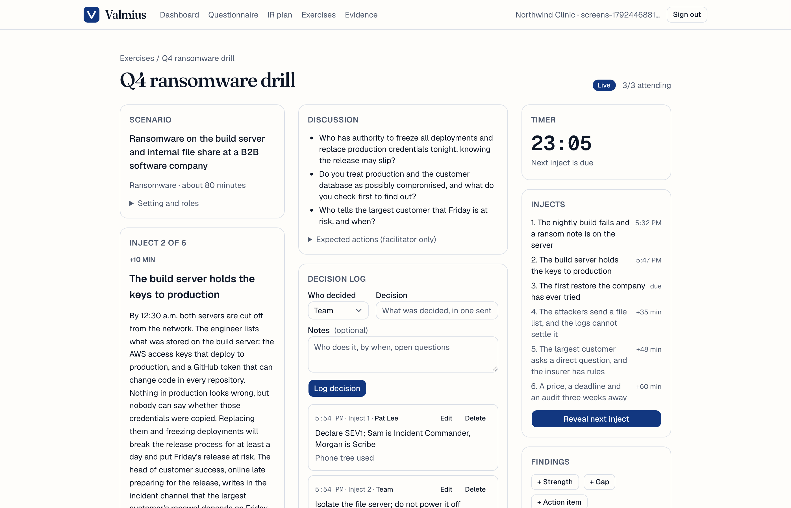

# Valmius

**Incident response plans and tabletop drills, with the evidence auditors ask for.**

Live: [valmius.app](https://valmius.app) · Built October 6 to 22, 2026 · Next.js 16, Supabase, TypeScript, Claude API



## What it does

Companies with 10 to 200 employees and no security team are required to have a written incident response (IR) plan and to test it, by PCI DSS (12.10.2, every 12 months), SOC 2 auditors (CC7.3 to CC7.5), NYDFS 500.16, and cyber insurance questionnaires. Today they wing it with a free template, or pay a consultant $5,000 to $50,000 to run one exercise. Valmius does the whole loop in a browser:

1. **Writes the plan.** A 15-question questionnaire produces an 11-section IR plan written for the company's actual systems, roles and obligations, with a notification matrix (deadlines per law and contract) built in code, not by the model. Versioned, approved and frozen by a database trigger; exported to PDF and Word.
2. **Runs the drill.** The facilitator picks a scenario pack or generates one from the plan; participants join from a phone with a link, no account. The console shows the current inject, discussion questions, a timer and a decision log where every entry gets a server timestamp. Ending the exercise locks the log.
3. **Produces the evidence.** The after-action report assembles the facts in code (attendance, sign-offs, server-stamped decision timeline, findings, control mapping) and lets the model write only the five narrative sections. Finalizing renders a PDF, stores it in a private bucket, records its SHA-256, and freezes the record. An evidence vault shows every exercise and when the next test is due per framework.

## Sample output

Generated for a fictional 30-person SaaS company, Ledgerline. Every person, firm and number in them is made up.

- [Incident response plan, 16 pages (PDF)](docs/samples/ledgerline-ir-plan.pdf)
- [After-action report from a cloud-credential drill, 5 pages (PDF)](docs/samples/ledgerline-after-action-report.pdf)

- Demo video: on github.com, open this file in the editor and drag a .mp4 (under 10 MB) onto the line below. GitHub uploads it and renders a player. -->

https://github.com/user-attachments/assets/accb4a3a-65d1-4685-9f47-a4ec60457db4


## Why the design looks the way it does

- **The model never decides anything that has to be right.** Framework references, the notification matrix, attendance, timestamps, hashes and control mapping are all computed. The model writes prose inside a fixed, reviewed structure, every response is validated against a zod schema (sent to the API as JSON schema), retried once, then replaced by a flagged template. Plan versions with template sections cannot be approved.
- **Evidence has to be tamper-evident.** Approved plans, ended exercise logs and finalized reports are frozen by Postgres triggers. Amendments are new versions; the old one stays on file and is marked superseded. Each report carries a content fingerprint, and the PDF's own SHA-256 lives in the vault beside the download.
- **Participants are people in a room, not users.** They join with a 32-byte token link, see only the revealed injects (never the facilitator's expected actions), confirm attendance and sign off by typed name. Tokens expire 30 days after the exercise ends.
- **Row Level Security is the access control.** Every table has explicit grants, RLS and policies; org data is read with the user's session, so a bug in application code cannot leak another organization's rows. An integration test proves cross-organization reads fail.
- **No regulated data.** The questionnaire asks whether a company handles card or health data, never for the data itself. Visitor IPs are stored as salted hashes. Secrets are server-only.
- **Honest claims.** The product says "produces the evidence auditors ask for under CC7.3 to CC7.5", never "makes you compliant". The coverage table in [SPEC.md section 9.1](SPEC.md) is explicit that this is 2 to 9% of any framework, the slice nobody else automates.

## Quality

- 170 tests: Vitest unit tests (offline, network blocked), a database suite against hosted Supabase (triggers, RLS, cascades), and Playwright end-to-end tests that drive a facilitator and a participant in two browser contexts, on desktop and iPhone 13 emulation.
- Tests never call the real model. A mock provider returns fixtures through the same validation as the real one; each phase also had one real-provider run read by a person, which caught an output-schema bug the mock could not.
- Accessibility to WCAG 2.2 AA: an axe sweep of 20 routes in the e2e suite must stay clean, plus a keyboard-only test that creates, runs and ends an exercise. Lighthouse on the deployed landing page: 100 accessibility, 93 (mobile) and 100 (desktop) performance.
- Rate limits on every public endpoint and every model-spending action, Dependabot, security headers, `/.well-known/security.txt`, MFA on every founder account.

## Stack

Next.js 16 (App Router, server actions), TypeScript strict, Tailwind and shadcn/ui, Supabase (Postgres, Auth with magic links, Storage), `@anthropic-ai/sdk` with `claude-sonnet-5-5`, `@react-pdf/renderer` and `docx` for exports, zod, Vitest, Playwright, axe. Deployed on Vercel; DNS and registrar at Cloudflare; transactional email through Resend.

## Compliance mapping

| Framework | Controls this product evidences |
|---|---|
| SOC 2 (TSC 2017) | CC7.3, CC7.4, CC7.5 |
| PCI DSS v4.0.1 | 12.10.1, 12.10.2, 12.10.6 |
| ISO/IEC 27001:2022 | A.5.24, A.5.26, A.5.27 |
| NIST CSF 2.0 / SP 800-61 Rev. 3 | ID.IM-02, ID.IM-04 |
| HIPAA Security Rule | 164.308(a)(6)(ii) |
| NYDFS 23 NYCRR 500 | 500.16 |
| CMMC 2.0 L2 / NIST 800-171 | 3.6.1 to 3.6.3 |

## How it was built

Spec-driven, in five phases over sixteen days, with Claude Code doing the implementation against [SPEC.md](SPEC.md). I owned the spec, the product decisions recorded in it, the security model, the manual checks with the real model at the end of every phase, the deployment and the launch checklist. Each phase shipped only after its acceptance tests passed. [CLAUDE.md](CLAUDE.md) holds the conventions and the gotchas that accumulated along the way.

## Status

MVP complete and deployed; not onboarding customers. I built this after scoring five cybersecurity ideas on stickiness, willingness to pay, competitive gap and tailwind. Three weeks of building and two rounds of feedback later, I found that TryHackMe had added unlimited AI tabletops with audit-ready reporting to a $99 to $199 per month training plan, which removed the price gap the idea depended on. I parked it rather than compete on price with a well-known brand, and I'm applying what the project taught me (validate with a browser and a trial, not just search results; lead with the evidence, not the document) to the next one.

## Running it locally

Requires Node 20+, pnpm, a Supabase project and an Anthropic API key. Copy `.env.example` to `.env.local`, follow [SUPABASE-SETUP.md](SUPABASE-SETUP.md), then:

```bash
pnpm install
pnpm db:migrate && pnpm db:seed
pnpm dev
```

`pnpm test` runs offline with the mock provider. `pnpm test:e2e` builds and starts its own server.
